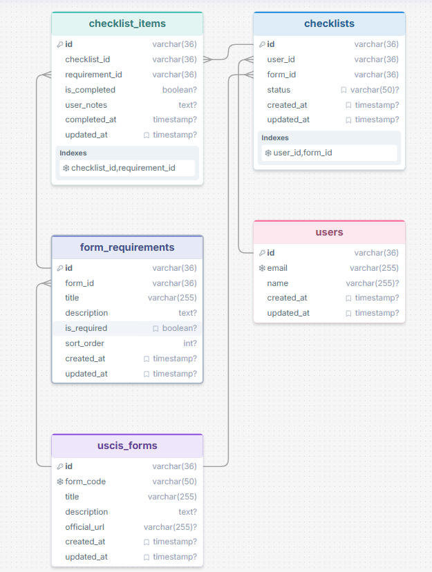

# USCIS Checklist Helper

## Description

A checklist database for USCIS forms. Each form lists the exact documents and steps it needs, and each user has a
checklist per form where they tick items off and keep notes. Ask it questions in plain English, like "What required
documents do I still need for my I-485?", and it answers using the data.

All data is fake: 2 users, 6 forms (I-130, I-485, I-765, N-400, I-90, I-131), 44 requirements, 4 checklists and
32 checklist items. The requirement lists summarize the public form instructions for demonstration only, and fees are
not stored because they change. This is information, not legal advice.

## Schema



* users: The people using the app.
* uscis_forms: A USCIS form, with its code (`I-485`), title, description and official URL.
* form_requirements: One document or step a form needs, with an `is_required` flag and a `sort_order`.
* checklists: One user's checklist for one form (unique per user and form), with a status.
* checklist_items: One requirement on one checklist, with `is_completed`, `user_notes` and `completed_at`.

## Overview of the Files

* main.py: CLI. Takes a question, sends it to OpenAI with the schema, runs the SQL it returns, then asks OpenAI to turn the rows into a plain answer.
* schema.sql: Creates the tables (the original MySQL design, adapted to SQLite).
* uscis_helper/: `seed_data.py` and `seed.py` build the fake data, `prompts.py` holds the three strategies, `database.py` and `sql_guard.py` run queries read-only, `language_model.py` is the only OpenAI code, `interface.py` ties the steps together.
* run_examples.py: Runs 12 questions with every strategy and writes `EXAMPLES.md`.
* [EXAMPLES.md](EXAMPLES.md): The SQL and answer for every question and strategy from the final run.

## Running It

1. `pip install -r requirements.txt`
2. Put `OPENAI_API_KEY=...` in a `.env` file (or export it).
3. `python main.py` (interactive) or `python main.py "your question"`. Add `--strategy zero-shot|single-domain|cross-domain`.

## Responses that worked

Question: "What percentage of my I-485 checklist have I completed?"

We chose this because it needs a calculation and has to be scoped to the person asking.

gpt-4o-mini, Zero-shot

```
SELECT (SUM(CASE WHEN ci.is_completed = 1 THEN 1 ELSE 0 END) * 100.0 / COUNT(*)) AS completion_percentage
FROM checklist_items ci
JOIN checklists c ON ci.checklist_id = c.id
WHERE c.user_id = :user_id AND c.form_id = (SELECT id FROM uscis_forms WHERE form_code = 'I-485');
```

Friendly Response: You have completed approximately 36.36% of your I-485 checklist.

gpt-4o-mini, Single-domain few-shot

```
SELECT (SUM(CASE WHEN ci.is_completed = 1 THEN 1 ELSE 0 END) * 100.0 / COUNT(*)) AS completion_percentage
FROM checklist_items ci
JOIN checklists c ON c.id = ci.checklist_id
JOIN uscis_forms f ON f.id = c.form_id
WHERE c.user_id = :user_id AND f.form_code = 'I-485';
```

Friendly Response: You have completed approximately 36.36% of your I-485 checklist.

gpt-4o-mini, Cross-domain few-shot

```
SELECT (SUM(CASE WHEN ci.is_completed = 1 THEN 1 ELSE 0 END) * 100.0 / COUNT(*)) AS completion_percentage
FROM checklist_items ci
JOIN checklists c ON ci.checklist_id = c.id
WHERE c.user_id = :user_id AND c.form_id = (SELECT id FROM uscis_forms WHERE form_code = 'I-485');
```

Friendly Response: You have completed approximately 36.36% of your I-485 checklist.

All three are correct (4 of 11 items). The SQL is written differently each time but means the same thing.

## Responses that did not worked

Question: "What required documents do I still need for my I-485?"

We chose this because it needs four tables and three conditions: this user, this form, required, not completed.
All three strategies produced SQL that ran without error and a confident answer, but only one was right. The correct
answer is 5 items. We checked by running the generated SQL ourselves: zero-shot returned 15 rows and cross-domain
returned 9, both mixing in the user's I-765 checklist.

gpt-4o-mini, Zero-shot

```
SELECT fr.title, fr.description, uf.form_code, u.name
FROM form_requirements fr
JOIN uscis_forms uf ON fr.form_id = uf.id
JOIN checklists c ON uf.id = c.form_id
JOIN checklist_items ci ON c.id = ci.checklist_id
JOIN users u ON c.user_id = u.id
WHERE c.user_id = :user_id AND c.status = 'IN_PROGRESS' AND fr.is_required = 1 AND ci.is_completed = 0;
```

Friendly Response: You still need the following required documents for your I-485: Signed Form I-485, Filing fee, Passport-style photos, Government-issued photo ID, Birth certificate, Passport page and I-94, Medical exam (Form I-693), Affidavit of Support (Form I-864).

This never joins `ci.requirement_id` to `fr.id` and never filters on I-485, so it lists items Maria already completed.

gpt-4o-mini, Single-domain few-shot

```
SELECT r.title
FROM checklist_items ci
JOIN checklists c ON c.id = ci.checklist_id
JOIN uscis_forms f ON f.id = c.form_id
JOIN form_requirements r ON r.id = ci.requirement_id
WHERE c.user_id = :user_id AND f.form_code = 'I-485' AND ci.is_completed = 0 AND r.is_required = 1
ORDER BY r.sort_order;
```

Friendly Response: You still need the following required documents for your I-485: Filing fee, Passport page and I-94, Medical exam (Form I-693), Affidavit of Support (Form I-864), Evidence of eligibility category.

Correct. This is the shape of the example question we gave it, which is probably why it got it right.

gpt-4o-mini, Cross-domain few-shot

```
SELECT fr.title, fr.description
FROM form_requirements fr
JOIN checklists c ON c.form_id = fr.form_id
WHERE c.user_id = :user_id AND c.status = 'IN_PROGRESS' AND fr.is_required = 1
  AND fr.id NOT IN (SELECT requirement_id FROM checklist_items WHERE checklist_id = c.id AND is_completed = 1);
```

Friendly Response: You still need the following required documents for your I-485: Filing fee, Passport page and I-94, Medical exam (Form I-693), Affidavit of Support (Form I-864), Evidence of eligibility category, Government-issued photo ID, Copy of Form I-94, Evidence of eligibility category (for category (c)(9)).

The first five are right. The last three come from the I-765 checklist, because there is no I-485 filter.

## Conclusion

I only ran gpt-4o-mini, so there is no model comparison. All three strategies got 9 of 11 answerable questions
right, but missed different ones, so the sample is too small to rank them. Single-domain was the only one to get the
hardest query above. The other weak spot was vocabulary: "Which forms need a medical exam?" failed twice because the
words are in the requirement's title and the SQL searched only the description.

The main lesson is that a wrong query looks fine: it runs, returns rows and gets a fluent answer. Prompt rules were
sometimes ignored, so anything that must hold (read-only, user scoping) is enforced in code. The earlier prompt
versions are in `docs/prompt_iterations/`.

Cost: one full run (about 70 calls) used about 37k prompt and 3.5k completion tokens, under one cent at gpt-4o-mini
rates.
